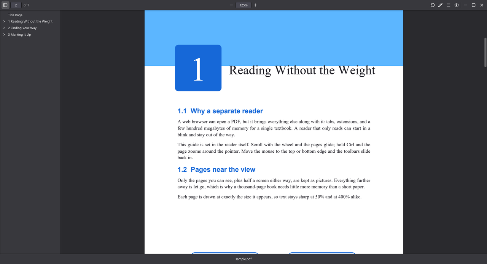

<p align="center">
  
</p>

<h1 align="center">rs-pdf-render</h1>

<p align="center">
  A small, fast PDF reader for the desktop, written in Rust.<br>
  Built because, as a student, I just wanted something to read PDFs with and
  not have a web browser drink my RAM or Adobe Acrobat's clunk around.
</p>

<p align="center">
  <a href="https://github.com/MelanCloud/rs-pdf-render/releases/latest"><b>Download for Windows</b></a>
  ·
  <a href="#features">Features</a>
  ·
  <a href="#keyboard-and-mouse">Shortcuts</a>
  ·
  <a href="#building">Building</a>
</p>

<p align="center">
  
</p>

It looks and behaves like Firefox's PDF viewer, minus everything a reader
doesn't need. The window has no frame: the toolbar slides in when the mouse
nears the top or bottom edge, and gets out of the way while you read.

- **Light.** One small program. A 1,100-page textbook stays at about 120 MB
  of memory, because only the pages near the view are kept.
- **Sharp.** Pages are drawn by [MuPDF](https://mupdf.com) and shown pixel
  for pixel, so text stays crisp and dark at any zoom.
- **Hands off your files.** It never changes a PDF. Drawings stay on screen
  only, until you close the file or print it.
- **Private.** It works offline and sends nothing anywhere.

## Download

**Windows 10 and 11 (64-bit):** get `rs-pdf-render-<version>-setup.exe` from
[Releases](https://github.com/MelanCloud/rs-pdf-render/releases) and run it.

- It installs for your user only, so no admin rights are needed. It can also
  install for everyone on the computer.
- To make it your default PDF app, tick "Choose it as the default PDF app" on
  the last page, or pick it later in Settings → Apps → Default apps. Windows
  doesn't let any installer do that by itself.
- The installer isn't code-signed yet, so Windows may say "Windows protected
  your PC". Choose **More info**, then **Run anyway**.
- Prefer no installer? The portable `.zip` on the same page runs from any
  folder.

To uninstall, use Settings → Apps. Your settings stay in
`%APPDATA%\rs-pdf-render` in case you come back.

macOS and Linux work when built from source (see [Building](#building)), but
there are no ready-made packages for them yet.

## Features

- **Zoom:** buttons, a box to type any zoom (`150` or `150%`), Ctrl + mouse
  wheel around the pointer, and pdf.js's zoom modes: Automatic, Page fit,
  Page width and 100%. The zoom level shows briefly in the bottom-right
  corner, like Acrobat. Text stays sharp even at 1000%.
- **Pages:** type a page number next to the page count, or rotate
  counterclockwise.
- **Search:** Find in the ☰ menu or Ctrl+F opens a find bar that searches the
  whole document as you type, ignoring case. All matches are highlighted,
  with "3 of 41" to step through them.
- **Select and copy:** drag across text to select it, even across pages;
  double-click selects a word and triple-click a line. Ctrl+A selects all
  and Ctrl+C copies.
- **Outline:** the document's table of contents in a sidebar. Optionally,
  the app scans the text for numbered subsections like "2.6.4" and adds them,
  for books whose own outline stops at the sections.
- **Links:** page links jump to the right spot; web and email links open in
  your browser. Back and Forward return you after a link or an outline entry.
- **Picks up where you left off:** each file reopens at the same page, zoom
  and rotation.
- **Pen:** a simple pen with four colors, undo and redo.
- **Print:** the system print dialog, with your drawings included.
- **Password-protected PDFs:** it asks for the password, like Firefox.
- **Light, dark or system theme.**
- **Settings** (the gear button): smooth scrolling, sliding or instant
  toolbars, always-visible toolbars, the zoom for new files, the scroll
  speed per wheel notch, and the subsection scan (off by default; what it
  finds is forgotten when the file closes). Smooth scrolling and sliding
  toolbars start off if Windows' "Animation effects" are off.

## Keyboard and mouse

On macOS, use ⌘ instead of Ctrl.

| Keys | Does |
| --- | --- |
| Ctrl+O | Open a PDF (or drop one on the window) |
| Ctrl+P | Print |
| Ctrl+F | Find in the document |
| Enter / Shift+Enter, F3 / Shift+F3 | Next / previous match |
| Ctrl+A / Ctrl+C | Select all text / copy the selection |
| Ctrl++ / Ctrl+- | Zoom in / out |
| Ctrl+0 | Back to the default zoom |
| Ctrl + mouse wheel | Zoom around the pointer |
| Home / End | First / last page |
| Page Up / Page Down / Space | Scroll a screen |
| Up / Down | Scroll a little |
| Alt+Left / Alt+Right | Back / Forward (also the mouse's side buttons; ⌘[ and ⌘] on macOS) |
| Ctrl+Z / Ctrl+Shift+Z | Undo / redo the last drawing |
| Esc | Close a menu, the password box or the find bar, or stop drawing |
| Enter | Apply what you typed in the page, zoom or password box |

Drag the top or bottom bar to move the window, and double-click it to
maximize.

## Privacy

The app sends nothing anywhere. Web links in a PDF open in your browser only
when you click them. The only files it writes are its own settings and the
reading positions of the last 50 files, in `%APPDATA%\rs-pdf-render`
(`~/Library/Application Support/rs-pdf-render` on macOS,
`~/.config/rs-pdf-render` on Linux).

## Building

You need [Rust](https://rustup.rs), a C compiler and LLVM's libclang: the
first build compiles MuPDF into the app, which takes a few minutes.

| System | Install |
| --- | --- |
| Windows | Visual Studio 2022 (or its Build Tools) with "Desktop development with C++", and LLVM: `winget install LLVM.LLVM` |
| macOS | The Xcode command line tools: `xcode-select --install` |
| Linux | A C compiler, `make` and libclang; on Debian and Ubuntu: `sudo apt install build-essential libclang-dev` |

Then:

```sh
cargo run --release -- path/to/file.pdf
```

The result is a single executable, `target/release/rs-pdf-render` (`.exe` on
Windows), with nothing else to copy along.

**Windows installer:** with [Inno Setup 6](https://jrsoftware.org/isinfo.php)
installed (`winget install JRSoftware.InnoSetup`), run
`ISCC installer\rs-pdf-render.iss` after the release build. The installer
lands in `target/installer/`.

### Printing on each system

- **Windows:** the system print dialog, then the app draws the pages for the
  printer at its full resolution.
- **macOS:** the system print sheet, with a preview.
- **Linux:** the document goes to the default printer with `lp`.

## Credits

- [MuPDF](https://mupdf.com) (AGPL-3.0, by Artifex) renders the pages,
  through the [mupdf](https://github.com/messense/mupdf-rs) Rust crate. Its
  license and those of the libraries built into it are in
  [licenses](licenses); the installer and the portable `.zip` include them.
- [iced](https://github.com/iced-rs/iced) (MIT) draws the interface.
- The icons, including the paperclip in the app icon, are from
  [Lucide](https://lucide.dev) (ISC).
- Behavior and colors follow Mozilla's [pdf.js](https://github.com/mozilla/pdf.js).

## License

Copyright © 2026 MelanCloud. rs-pdf-render is free software under the GNU
Affero General Public License, version 3 or later, as MuPDF requires; see
[LICENSE](LICENSE). The source code is this repository.
